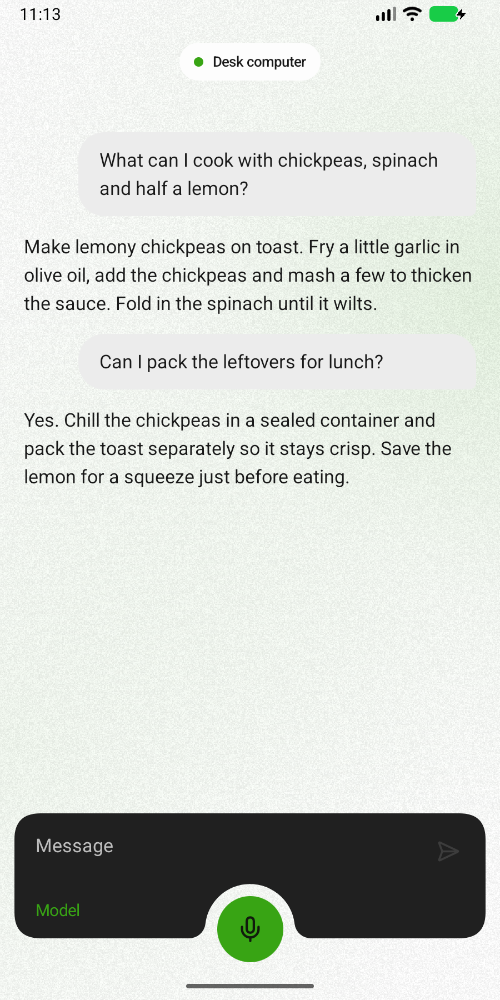
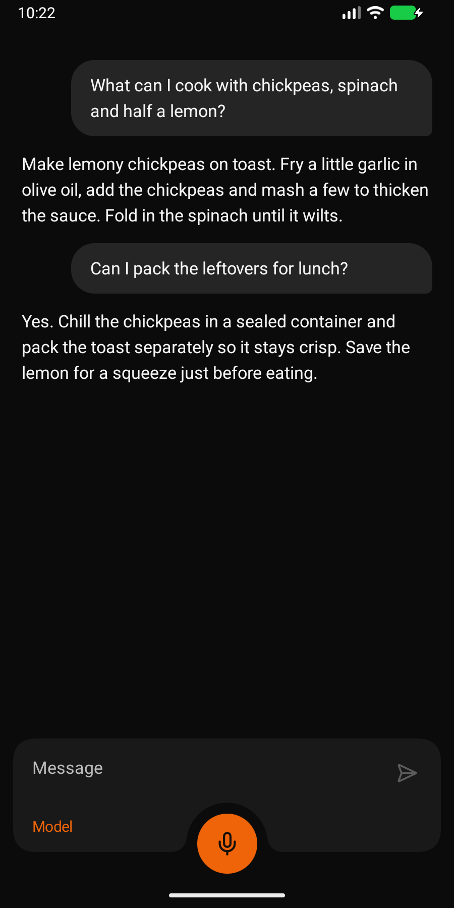
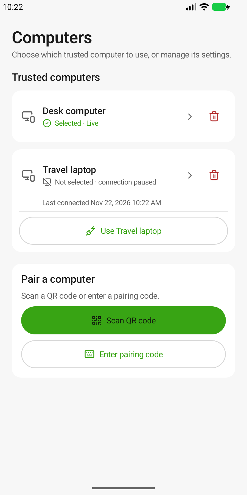
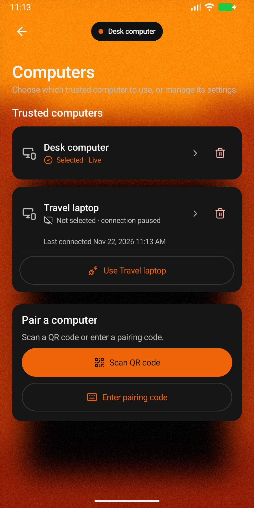

# Kompi

**A personal assistant on your Android phone, powered by the [Pi](https://pi.dev/) you already use on your computer.**

I built Kompi (*Pi companion*) because not everything I want from Pi is a coding task. Sometimes I’m in the kitchen with half a lemon and a can of chickpeas, and I’d rather ask what to cook than open a terminal. Other times I *do* want to pick up the coding session I left at my desk. Kompi lets me do both: the conversation is on my phone, but Pi still has the files, tools, and settings on my computer.

[Get Kompi](#first-chat) · [Latest release](https://github.com/karlis-vagalis/kompi/releases/latest)

**Demo gallery.** Android emulator screenshots with a fictional conversation and simulated paired computers.

| Light | Dark |
| --- | --- |
| [](docs/screenshots/chat-light.png) | [](docs/screenshots/chat-dark.png) |
| [](docs/screenshots/computers-light.png) | [](docs/screenshots/computers-dark.png) |

## What you can do with Kompi

- **Talk while your hands are busy.** Switch to Live mode for a spoken conversation, hear Pi’s reply, and interrupt with a follow-up. If you’d rather review your words first, dictate into the chat box instead. Live mode uses two downloadable speech models on your phone: **Parakeet** turns your voice into text, and **Kokoro** reads the reply aloud. In between, Kompi sends the transcript—not your microphone audio—to Pi on your paired computer, which uses your configured model provider to answer.
- **Bring something into the conversation.** Share a screenshot from another Android app, add a question, and review the draft before sending it. No need to move the image to your computer first.
- **Ask for an action on the phone itself.** Ask Pi to set a kitchen timer, open directions, or draft a text in your messaging app. Kompi uses Android’s own apps for these actions; drafting a message isn’t the same as sending it. You can also choose Kompi as Android’s digital assistant.
- **Pick up where you left off.** Browse Pi sessions on a paired computer and continue an existing conversation instead of explaining the context again. Pair more than one computer and choose which one to talk to. [iroh](https://www.iroh.computer/) encrypts the connection and uses a direct route when possible or a relay when needed.

> **Development status:** Kompi is under very active development. Expect breaking changes between versions. Use it at your own risk.

## First chat

<a href="https://apps.obtainium.imranr.dev/redirect?r=obtainium://app/%7B%22id%22%3A%22com.kompi.app%22%2C%22url%22%3A%22https%3A%2F%2Fgithub.com%2Fkarlis-vagalis%2Fkompi%22%2C%22author%22%3A%22karlis-vagalis%22%2C%22name%22%3A%22Kompi%22%7D"></a>

1. On your phone, add Kompi to Obtainium above or [download the Android APK](https://github.com/karlis-vagalis/kompi/releases/latest/download/kompi.apk) directly. Open the APK to install it. If Android asks, allow installation from the app you opened it with.
2. On your x86-64 computer, install Pi, Node.js 22.19+ and Bun (Linux also needs `flock`). Install the daemon for your platform:

   **GNU Linux**
   ```sh
   curl -fsSL https://github.com/karlis-vagalis/kompi/releases/latest/download/kompi-daemon-installer.sh | sh
   ```

   **Windows PowerShell**
   ```powershell
   irm https://github.com/karlis-vagalis/kompi/releases/latest/download/kompi-daemon-installer.ps1 | iex
   ```

   If your system policy doesn't allow the installer, download the [Linux archive](https://github.com/karlis-vagalis/kompi/releases/latest/download/kompi-daemon-x86_64-unknown-linux-gnu.tar.gz) or [Windows ZIP](https://github.com/karlis-vagalis/kompi/releases/latest/download/kompi-daemon-x86_64-pc-windows-msvc.zip) instead. Extract into a dedicated directory and use the full path to the extracted executable in place of `kompi` below.

3. Open a new terminal and start Pi’s companion:

   ```sh
   kompi serve
   ```

4. In another terminal, run `kompi pair`. On the phone, open **Computers** and scan the code. Send “Hello” to try it.

Prefer to build locally? See the [host](daemon/README.md) and [Android](android/README.md) instructions.

**Access and privacy:** A paired phone can run Pi as your host user. Keep pairing codes private. Pi stores transcripts on the host; the phone caches chat data, and Pi sends requests to your configured model provider. To remove access, find the phone with `kompi devices list` and run `kompi devices revoke <endpoint>`.

**Upgrading:** Check the release notes for breaking changes and update the app and daemon together. Stop the daemon, rerun the installer and restart. Starting with v0.1.1, the installer includes the worker modules; you no longer need to run `bun install`. If you’re staying on v0.1.0, follow the [older worker setup](daemon/README.md#released-worker-setup).

**Why use Pi directly?** Pi Durable might be a better fit for session management, but I wanted one Pi setup to maintain. Kompi runs the same Pi CLI I use in the terminal, so both use the same settings, credentials, and extensions.

## Uninstall

**Android:** To revoke the phone’s access, run `kompi devices list` on each paired computer, then `kompi devices revoke <endpoint>` while its daemon is running. Uninstall Kompi from Android and, if you use Obtainium, remove its tracking entry. Uninstalling the app does not delete Pi transcripts on your computer.

**Linux or Windows:** Stop `kompi serve` with Ctrl+C (or stop and disable the service if you configured one). Locate the installed executable with `command -v kompi` on Linux or `(Get-Command kompi.exe).Source` in PowerShell. Delete that executable and the `kompi-runtime-<hash>` folders beside it, **not** the shared `bin` directory. If you used a release archive in a dedicated folder, remove that folder instead.

**Optional: erase pairing and local state.** With the daemon stopped, remove only `.pi/agent/kompi-native` under your home directory, or the dedicated state directory you configured with `--state-dir` or `KOMPI_STATE_DIR`. This deletes the host’s Kompi identity and pairings. Leave the rest of `.pi` intact to keep your Pi settings and conversations.

Kompi is licensed under [AGPL-3.0-only](LICENSE). Third-party components retain their own licenses.

Run `just` to list the [development recipes](justfile) · [Contributing](CONTRIBUTING.md) · [Release details](docs/releasing.md)
