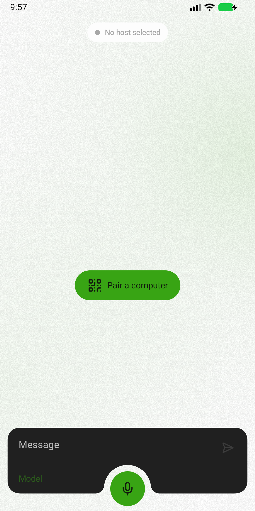
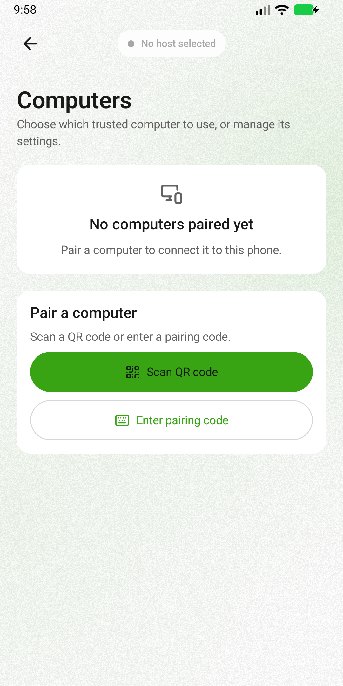
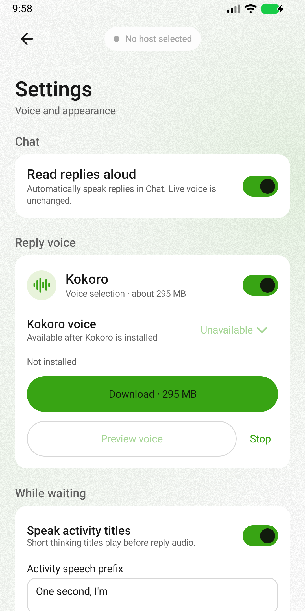

# Kompi

**Your personal Pi assistant on Android. Send a message or talk in Live mode.**

There are already good ways to run a coding agent from a phone. I built Kompi (*Pi companion*) because I wanted an assistant I could talk to without turning every request into a coding task. Type a quick message, or switch to Live mode for a spoken conversation. Pi runs on your paired computer, so when you *do* want to work on code, you can pick up an existing session with its files and tools.

  
  
  

> **Development status:** Kompi is under very active development. Expect breaking changes between versions. Use it at your own risk.

## First chat

1. On an x86-64 Linux computer, install and configure the Pi CLI. Check that you can get a reply in the terminal. Install Rust, Node.js 22.19+, Bun and util-linux (`flock`), then follow the [host build and launch commands](daemon/README.md).
2. Follow the [Android build instructions](android/README.md). Install the resulting debug APK on your phone, for example with `adb -s <serial> install -r android/app/build/outputs/apk/debug/app-debug.apk` from the repository root.
3. With the daemon running, open another terminal at the repository root and run `target/release/kompi pair`. In the app, open Computers and scan the pairing code. Send “Hello” to check the connection.

This is a source release. Binary releases are gated pending [dependency review](daemon/DEPENDENCIES.md) and [Android redistribution review](android/dependencies.md).

**Access and privacy:** A paired phone can run Pi as your host user. Keep pairing codes private. Pi stores transcripts on the host; the phone caches chat data, and Pi sends requests to your configured model provider. To remove access, find the phone with `target/release/kompi devices list` and run `target/release/kompi devices revoke <endpoint>`.

**Upgrading:** Check the release notes for breaking changes and update the app and daemon together.

**Why use Pi directly?** Pi Durable might be a better fit for session management, but I wanted one Pi setup to maintain. Kompi runs the same Pi CLI I use in the terminal, so both use the same settings, credentials, and extensions.

Kompi is licensed under [AGPL-3.0-only](LICENSE). Third-party components retain their own licenses.

Run `just` to list the [development recipes](justfile) · [Contributing](CONTRIBUTING.md) · [Release details](docs/releasing.md)
